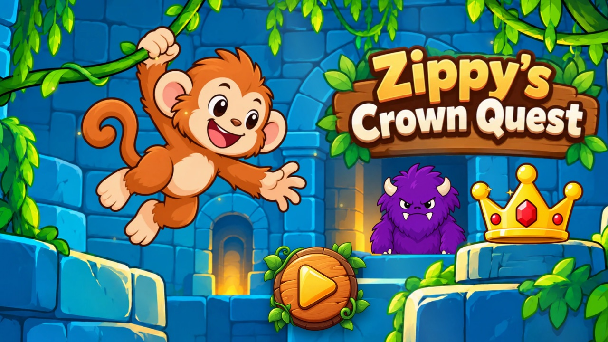
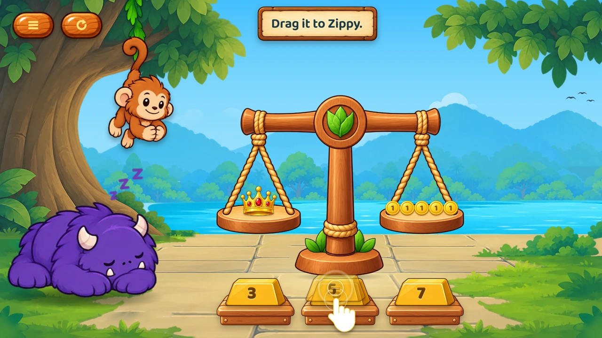

## Hi there 👋

### 🎮 Featured game: Zippy's Crown Quest

A maths game for kids about linear equations. Zippy the monkey has to swap each crown for a gold bar of the same mass without tipping the balance and waking Grumble. Children start by trying bars on the balance, then write the balance as an equation, check a solution, and solve for x.

**[▶ Play it](https://crown-quest-ten.vercel.app)** · [Code](https://github.com/aniketchauhan-star/crown-quest)

<!--
**aniketchauhan-star/aniketchauhan-star** is a ✨ _special_ ✨ repository because its `README.md` (this file) appears on your GitHub profile.

Here are some ideas to get you started:

- 🔭 I’m currently working on ...
- 🌱 I’m currently learning ...
- 👯 I’m looking to collaborate on ...
- 🤔 I’m looking for help with ...
- 💬 Ask me about ...
- 📫 How to reach me: ...
- 😄 Pronouns: ...
- ⚡ Fun fact: ...
-->
