<!--
  NEO-DELHI GRID · 2099 — GitHub profile of Aniket Chauhan
  Every visual lives in /assets as an animated SVG (pure CSS/SMIL, no JavaScript).
  Typefaces are embedded as renamed subsets under the SIL Open Font License 1.1.
-->



 


> **"I build digital experiences where design, technology and storytelling become one."**

- 🎨 **Design** — UI/UX designer: user flows, interfaces, motion and visual storytelling, from first sketch to polished screen
- 💻 **Develop** — I build what I design in HTML, CSS, JavaScript, TypeScript and React, with Three.js for real-time 3D
- 🛰️ **Now** — AI Content Designer at **ConveGenius.AI**, designing and coding learning games and 3D storybooks for classrooms
- 🎮 **Shipped** — 17 live builds: maths adventures, a 3D bike race, interactive flipbooks, a 3D portfolio
- 🎓 **Studied** — BA English Language & Literature, Delhi University &nbsp;·&nbsp; 📍 Delhi, India

 


 

  

 

  <a href="https://crown-quest-ten.vercel.app"></a>
  <a href="https://cannon-quest.vercel.app"></a>
  <a href="https://bike-game-gamma.vercel.app"></a>
  <a href="https://profit-and-discount-game.vercel.app"></a>
  <a href="https://ira-rahman-construction.vercel.app"></a>
  <a href="https://portfolio-aniket-five.vercel.app"></a>
  <a href="https://distance-formula.vercel.app"></a>
  <a href="https://portfolio-aniket-five.vercel.app"></a>

⌬ SOURCE DOCK —
<a href="https://github.com/aniketchauhan-star/crown-quest">crown-quest</a> ·
<a href="https://github.com/aniketchauhan-star/cannon-quest">cannon-quest</a> ·
<a href="https://github.com/aniketchauhan-star/bike-game">bike-game</a> ·
<a href="https://github.com/aniketchauhan-star/profit-and-discount-game">profit-and-discount-game</a> ·
<a href="https://github.com/aniketchauhan-star/distance-formula">distance-formula</a> ·
<a href="https://github.com/aniketchauhan-star/portfolio-Aniket">portfolio-Aniket</a>

 

| 3D storybook | What happens inside | Launch |
|:--|:--|:-:|
| 🤖 **Power Up, Bots!** | A maths picture book that turns in 3D. Cut an energy block into equal halves with a laser to charge the bots | [▶ Play](https://powerupp-bots.vercel.app) [Code](https://github.com/aniketchauhan-star/powerupp-bots) |
| 🐟 **The Great Fish Rescue** | Find the desert ponds, then sort and count fish in two games bound into the book | [▶ Play](https://fishrescue.vercel.app) [Code](https://github.com/aniketchauhan-star/fishrescue) |
| 💾 **Byte Saves the Day** | Byte's Energy Hunt and Right & Left, played between the pages | [▶ Play](https://byte-save.vercel.app) [Code](https://github.com/aniketchauhan-star/byte-save) |
| 🌸 **The Royal Bloom Fest** | Aru and Pari's palace festival, with a heavier-or-lighter weighing game on page five | [▶ Play](https://bloom-fest-tawny.vercel.app) [Code](https://github.com/aniketchauhan-star/bloom-fest-) |
| 🎉 **Saving the Parade** | Story pages with the PowerUp Bots equal-parts game bound in after page three | [▶ Play](https://saving-the-parade.vercel.app) [Code](https://github.com/aniketchauhan-star/saving-the-parade) |
| 🏰 **The Palace Turns 25** | Six story clips, then a party page with tappable hotspots: disco ball, Gogo's dance and bubbles | [▶ Play](https://palace-turn-24.vercel.app) [Code](https://github.com/aniketchauhan-star/palace-turn-24) |
| 📖 **Kabir & Gogo** | A hardcover flipbook with peel-over video pages | [▶ Play](https://kabir-and-gogo.vercel.app) [Code](https://github.com/aniketchauhan-star/kabir-and-gogo) |
| 👑 **Kabir and the Lost Princess** | A 3D video storybook on the same flipbook engine | [▶ Play](https://the-kabir-and-lost-princess.vercel.app) [Code](https://github.com/aniketchauhan-star/the-kabir-and-lost-princess) |
| 🎭 **The Fancy Dress Competition** | Heavy & Light and How Many Blocks?, two games inside the story | [Code](https://github.com/aniketchauhan-star/fancy-dress-1-new-) |
| ⚖️ **Fancy Dress 2 · Balancing Act** | A Unity learning game rebuilt in plain HTML/JS, with four weighing levels | [Code](https://github.com/aniketchauhan-star/fancy-dress-2) |

| Mini learning game | What you do | Launch |
|:--|:--|:-:|
| 🪶 **Heavy and Light** | Eight rounds on a working balance scale, from apple vs watermelon to dog vs elephant | [▶ Play](https://heavy-and-light-game.vercel.app) [Code](https://github.com/aniketchauhan-star/heavy-and-light-game-) |
| 📍 **Co-Ordinate Geometry** | Missions on a coordinate grid, with cinematic intros and voiced briefings | [▶ Play](https://co-ordinate-geometry.vercel.app) [Code](https://github.com/aniketchauhan-star/Co-Ordinate-Geometry) |

 

  
  

  

 

### HAVE AN IDEA? &nbsp;LET'S CREATE SOMETHING UNEXPECTED.

  


